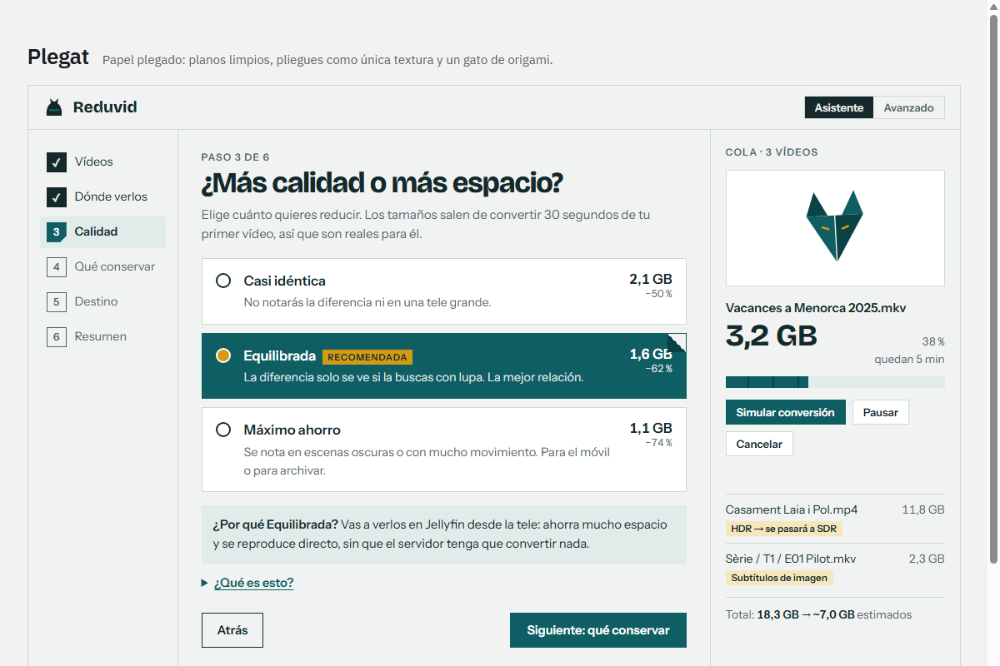
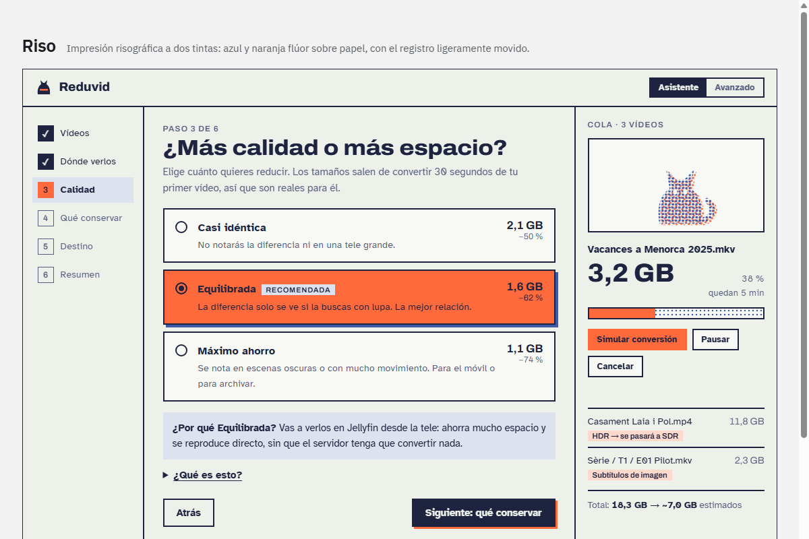
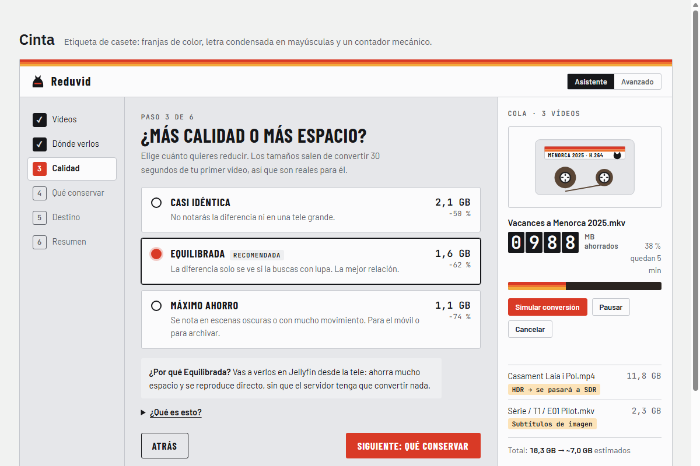

# Reduvid

[Castellano](README.md) · **English**

Easy, cross-platform video compressor for your Jellyfin library: shrink files with H.264/H.265 while keeping subtitles and chapters. Step-by-step wizard. Powered by FFmpeg.

## What it is

Reduvid (from *reducir vídeo*, Spanish for "shrink video") is a desktop app for Linux and Windows that makes your videos smaller with very little quality loss. It uses [FFmpeg](https://ffmpeg.org/) under the hood, but you don't need to know anything about codecs: a wizard asks where you'll watch the videos and how much space you want to save, and explains every option in plain language.

- **Your originals stay untouched.** Reduvid writes a new file, checks that it is complete, and only then gives it its final name. It never overwrites anything.
- **Built for Jellyfin.** A "Jellyfin compatible" profile produces video that plays directly on almost any device, without the server having to convert it.
- **Keeps what matters:** subtitles, chapters, audio tracks and languages, metadata and cover art.
- **For everyone:** Wizard mode (one decision per screen), Advanced mode (everything in one view), and a command line for servers and scripts.

## Project status

In development. The current version (0.1.0) can already convert videos from the command line; the graphical interface arrives in 0.2.0. Plan:

| Version | Contents |
|---|---|
| 0.1.0 | Conversion engine and command line |
| 0.2.0 | Graphical interface, wizard and languages (Català, Castellano, English) |
| 0.3.0 | Sample test, estimates, final report and saved profiles |
| 0.4.0 → 1.0.0 | Linux and Windows installers and first stable release |

Details in [TODO.en.md](TODO.en.md) and the [CHANGELOG](CHANGELOG.en.md).

## Screenshots

The interface doesn't exist yet (it arrives in version 0.2.0). These are the design mockups showing the three visual directions to choose between; **Plegat** is the default pick. Full interactive mockup in [docs/design/mockups.html](docs/design/mockups.html).

| Plegat (default) | Riso | Cinta |
|---|---|---|
| [](docs/design/screenshots/plegat.png) | [](docs/design/screenshots/riso.png) | [](docs/design/screenshots/cinta.png) |

## Requirements

- Linux or Windows 10/11.
- Python 3.11 or later, until installers exist.
- **FFmpeg** with `libx264` and `libx265`. Reduvid does not include it: it uses the one you have installed.

## Installation

1. Install FFmpeg:
   - Debian / Ubuntu: `sudo apt install ffmpeg`
   - Windows: `winget install Gyan.FFmpeg`, or download it from [ffmpeg.org](https://ffmpeg.org/download.html) and add it to your `PATH`.
2. Install Reduvid from source:

   ```bash
   git clone https://github.com/catlinux/Reduvid.git
   cd Reduvid
   python -m venv .venv
   # Linux: source .venv/bin/activate    Windows: .venv\Scripts\activate
   python -m pip install -e .
   ```

Packages for `pipx`, a Windows installer and a Linux AppImage are planned from version 0.4.0.

## Quick start

```bash
reduvid probe video.mkv              # See what a video contains
reduvid convert video.mkv            # Convert it with the default Jellyfin profile
reduvid convert folder/ --recursive  # Convert an entire folder
```

Full details on commands, options and exit codes in the [command-line guide](docs/en/cli.md).

## H.264 or H.265 for Jellyfin?

| | H.264 ("Jellyfin compatible") | H.265 / HEVC |
|---|---|---|
| Typical savings | 20-40 % | 40-70 % |
| Plays directly on | Almost everything: TVs, phones, browsers | Modern devices; elsewhere Jellyfin converts it on the server or fails |
| Choose it if | You watch on several devices, or you're not sure | Your devices are modern, or you only want to archive |

These figures are rough and depend on each video; Reduvid's sample test (version 0.3.0) gives the real number. Even with a compatible codec, Jellyfin also transcodes 10-bit video, HDR, some image subtitles (PGS, VobSub) and DTS or TrueHD audio. Reduvid warns about each case and suggests a fix.

## Privacy

Reduvid has no telemetry or usage statistics and does not connect to the internet. Everything happens on your computer.

## FFmpeg and licensing

Reduvid does not include or distribute FFmpeg or any codec. It runs FFmpeg as a separate program, passing it arguments, without linking or bundling its libraries. FFmpeg builds with `libx264` and `libx265` are usually GPL-licensed; that license governs FFmpeg, not Reduvid. If you redistribute FFmpeg (for example, alongside Reduvid), complying with its license is up to you. In some countries H.264 and H.265 are covered by patents.

Dependency licenses are listed in [THIRD_PARTY_NOTICES.md](THIRD_PARTY_NOTICES.md).

## Contributing

Contributions are welcome, translations included. Please read [CONTRIBUTING.en.md](CONTRIBUTING.en.md) and the [code of conduct](CODE_OF_CONDUCT.md). To report a security issue, see [SECURITY.md](SECURITY.md).

## Credits and license

**Reduvid** is developed and maintained by **Catlinux** ([github.com/catlinux](https://github.com/catlinux)).
Copyright (C) 2026 Catlinux.

Licensed under [WNCL-CU-1.0](LICENSE): free to use for any purpose, including commercial work, and to modify and share at no cost. No one may charge for the software or its use; only support and implementation services may be paid. It is not an OSI-approved Open Source license.

Copies and forks must keep this attribution and link to https://github.com/catlinux/Reduvid.

### Third-party material

| Component | Author | License | Link |
| --- | --- | --- | --- |

This repository contains no third-party material. Dependencies installed separately keep their own licenses and are listed in [THIRD_PARTY_NOTICES.md](THIRD_PARTY_NOTICES.md).
