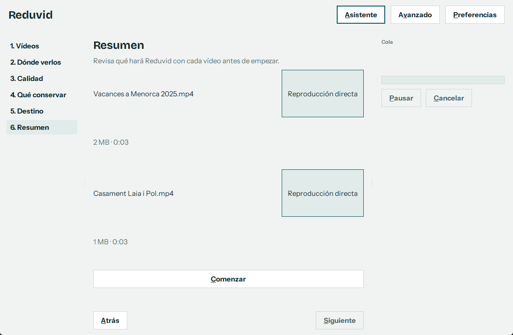
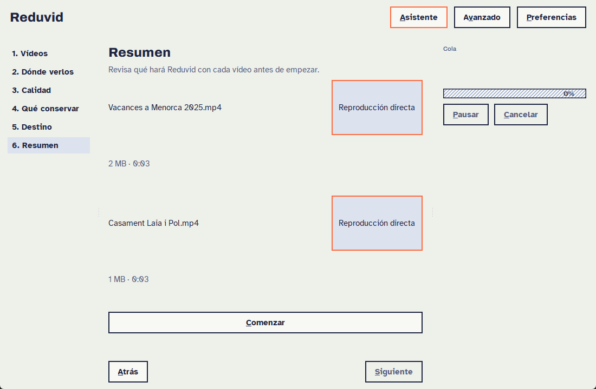
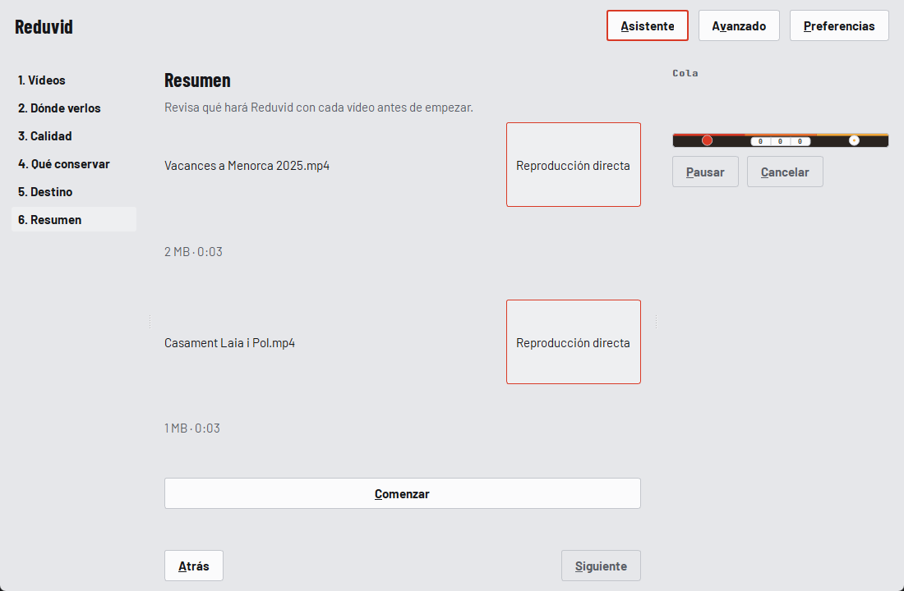
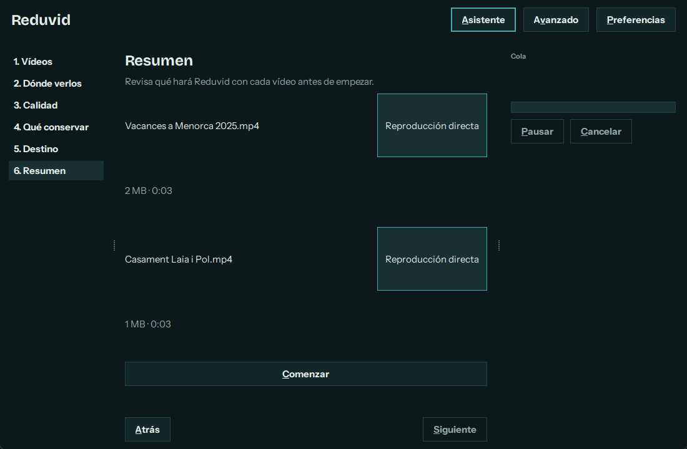
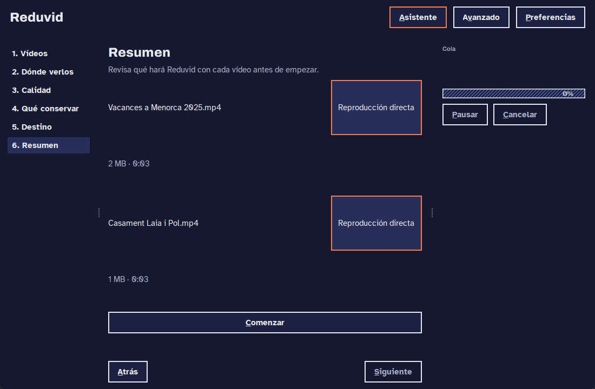
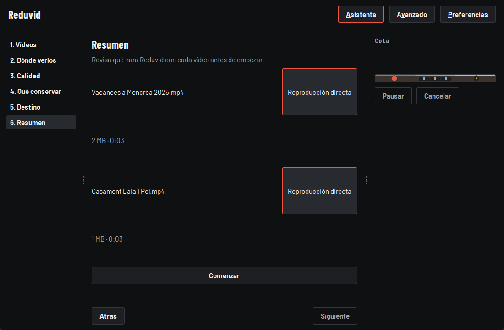

# Reduvid

**Castellano** · [English](README.en.md)

Compresor de vídeo fácil y multiplataforma pensado para bibliotecas de [Cinecat](https://github.com/catlinux/Cinecat), el servidor multimedia del autor: reduce el tamaño con H.264/H.265 conservando subtítulos y capítulos. Con asistente paso a paso. Basado en FFmpeg.

## Qué es

Reduvid (de *reducir vídeo*) es una aplicación de escritorio para Linux y Windows que reduce el tamaño de tus vídeos perdiendo muy poca calidad. Por debajo usa [FFmpeg](https://ffmpeg.org/), pero no hace falta saber nada de códecs: un asistente te pregunta dónde vas a ver los vídeos y cuánto quieres ahorrar, y explica cada opción en lenguaje llano.

- **Tus originales no se tocan.** Reduvid escribe un archivo nuevo, comprueba que está completo y solo entonces lo deja con su nombre final. Nunca sobrescribe nada.
- **Pensado para Cinecat.** Un perfil «Cinecat» genera MP4 con H.264 de 8 bits que Cinecat reproduce directo en el navegador, sin que el servidor tenga que convertirlo.
- **Conserva lo importante:** subtítulos, capítulos, pistas de audio e idiomas, metadatos y portada.
- **Para todos:** modo Asistente (una decisión por pantalla) y modo Avanzado (todo en una vista), más una línea de órdenes para servidores y scripts.

## Estado del proyecto

En desarrollo. La versión actual (0.5.2) ya tiene interfaz gráfica, asistente paso a paso y línea de órdenes. Plan:

| Versión | Contenido |
|---|---|
| 0.1.0 | Motor de conversión y línea de órdenes |
| 0.2.0 | Interfaz gráfica, asistente e idiomas (català, castellano, English) |
| 0.3.0 | Elegir pistas de audio una a una, reducir el peso del audio y ver cuánto pesa cada parte |
| 0.4.0 | Prueba de muestra: tamaño y tiempo estimados antes de convertir |
| 0.5.0 | Opciones de vídeo claras: qué cambia, tamaño estimado por nivel de calidad y resolución |
| 0.6.0 | Informe final, perfiles guardados y avisos de HDR, 10 bits y subtítulos de imagen |
| 0.7.0 → 1.0.0 | Instaladores para Linux y Windows y primera versión estable |

Detalle en [TODO.md](TODO.md) y en el [CHANGELOG](CHANGELOG.md).

## Capturas

El asistente, en sus tres temas intercambiables; **Plegat** es el tema por defecto. Más capturas y el uso completo de la interfaz en la [guía de la interfaz gráfica](docs/es/gui.md).

| Plegat | Riso | Cinta |
|---|---|---|
| [](docs/screenshots/plegat_light.png) | [](docs/screenshots/riso_light.png) | [](docs/screenshots/cinta_light.png) |

<details>
<summary>Modo oscuro</summary>

| Plegat | Riso | Cinta |
|---|---|---|
| [](docs/screenshots/plegat_dark.png) | [](docs/screenshots/riso_dark.png) | [](docs/screenshots/cinta_dark.png) |

</details>

Maquetas de diseño originales en [docs/design/mockups.html](docs/design/mockups.html).

## Requisitos

- Linux o Windows 10/11.
- Python 3.11 o posterior, mientras no haya instaladores.
- **FFmpeg** con `libx264` y `libx265`. Reduvid no lo incluye: usa el que tengas instalado.

## Instalación

1. Instala FFmpeg:
   - Debian / Ubuntu: `sudo apt install ffmpeg`
   - Windows: `winget install Gyan.FFmpeg`, o descárgalo de [ffmpeg.org](https://ffmpeg.org/download.html) y añádelo al `PATH`.
2. Instala Reduvid desde el código fuente:

   ```bash
   git clone https://github.com/catlinux/Reduvid.git
   cd Reduvid
   # En Debian/Ubuntu el comando es python3 (si falla: sudo apt install python3-venv)
   python3 -m venv .venv          # Windows: py -m venv .venv
   source .venv/bin/activate    # Windows: .venv\Scripts\activate
   python -m pip install -e .
   ```

Para generar un instalador de Windows o un AppImage de Linux en lugar de ejecutar desde el código fuente, consulta la [guía de instaladores](docs/es/instalacion.md). El paquete con `pipx` llegará más adelante.

## Uso rápido

`reduvid` abre la interfaz gráfica. La línea de órdenes es `reduvid-cli`:

```bash
reduvid-cli probe video.mkv              # Ver qué contiene un vídeo
reduvid-cli convert video.mkv            # Convertirlo con el perfil Cinecat por defecto
reduvid-cli convert carpeta/ --recursive # Convertir una carpeta entera
```

Guía de la interfaz (asistente y modo Avanzado) en [docs/es/gui.md](docs/es/gui.md). Detalle completo de órdenes, opciones y códigos de salida en la [guía de la línea de órdenes](docs/es/cli.md).

## ¿H.264 o H.265 para Cinecat?

| | H.264 de 8 bits en MP4 («Cinecat») | H.265 / HEVC («modern») |
|---|---|---|
| Ahorro orientativo | 20-40 % | 40-70 % |
| Se reproduce directo en Cinecat | Sí, en el navegador | No: Cinecat lo convierte mientras se ve |
| Recomendado si | Lo ves en el navegador o no lo sabes | Tus dispositivos son modernos, o solo quieres archivar |

Cinecat solo reproduce directamente MP4 en el navegador. El H.264 de 8 bits en MP4 es lo que funciona en todos los navegadores; para que Cinecat no tenga que convertir nada, el vídeo debe ser H.264 de 8 bits y hasta 1080p, y el audio AAC o MP3. El perfil Cinecat ya lo prepara así, pasa el HDR a SDR y descarta los subtítulos de imagen con un aviso. H.265 ocupa menos, pero Cinecat tendrá que convertirlo mientras lo ves y eso gasta CPU del servidor. Las cifras son orientativas y dependen de cada vídeo; la prueba de muestra de Reduvid (desde la 0.4.0) da el dato real.

## Privacidad

Reduvid no tiene telemetría ni estadísticas de uso. La única conexión de red es la comprobación de actualizaciones: como mucho una vez cada 24 horas, al arrancar y en segundo plano, consulta las releases públicas de GitHub. Solo se envía la petición con la cabecera `User-Agent: Reduvid/<versión>`, sin identificadores ni datos de uso. Viene activada por defecto y se desactiva en Preferencias con **Buscar actualizaciones automáticamente**. Las actualizaciones se descargan solo por HTTPS y se verifican con `SHA256SUMS`; esto protege de descargas corruptas, no de una cuenta de GitHub comprometida. No hay firma de código, así que Windows SmartScreen puede avisar de «editor desconocido».

## FFmpeg y licencias

Reduvid no incluye ni distribuye FFmpeg ni ningún códec. Lo ejecuta como un programa aparte, pasándole argumentos, sin enlazar ni incorporar sus bibliotecas. Las compilaciones de FFmpeg con `libx264` y `libx265` suelen estar bajo GPL; esa licencia rige FFmpeg, no Reduvid. Si redistribuyes FFmpeg (por ejemplo, junto a Reduvid), cumplir su licencia te corresponde a ti. En algunos países, H.264 y H.265 están sujetos a patentes.

Las licencias de las dependencias están en [THIRD_PARTY_NOTICES.md](THIRD_PARTY_NOTICES.md).

## Contribuir

Las aportaciones son bienvenidas, incluidas las traducciones. Lee [CONTRIBUTING.md](CONTRIBUTING.md) y el [código de conducta](CODE_OF_CONDUCT.md). Para avisar de un problema de seguridad, consulta [SECURITY.md](SECURITY.md).

## Créditos y licencia

**Reduvid** está desarrollado y mantenido por **Catlinux** ([github.com/catlinux](https://github.com/catlinux)).
Copyright (C) 2026 Catlinux.

Licencia [WNCL-CU-1.0](LICENSE): puedes usarlo gratis para cualquier fin, también comercial, y modificarlo y compartirlo sin coste. Nadie puede cobrar por el software ni por su uso; solo se pueden cobrar servicios de soporte e implementación. No es una licencia Open Source aprobada por OSI.

Las copias y los forks deben conservar esta atribución y enlazar a https://github.com/catlinux/Reduvid.

### Material de terceros

| Componente | Autor | Licencia | Enlace |
| --- | --- | --- | --- |

Este repositorio no contiene material de terceros. Las dependencias que se instalan aparte conservan su licencia y se detallan en [THIRD_PARTY_NOTICES.md](THIRD_PARTY_NOTICES.md).
